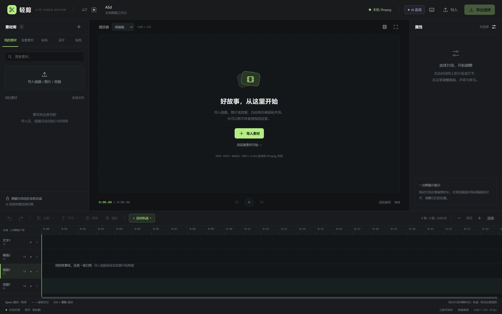
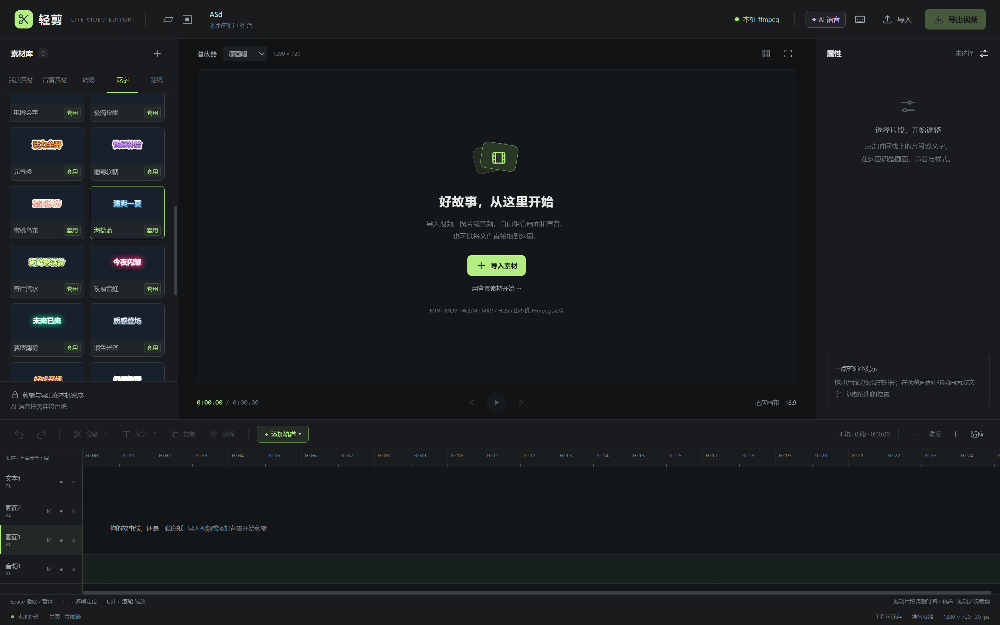
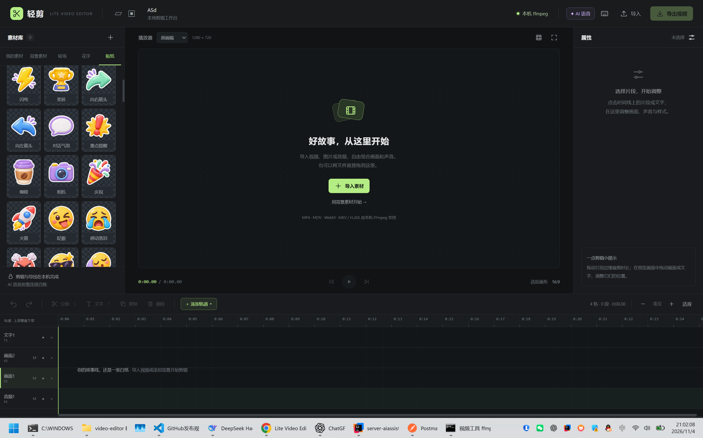

# 轻剪 · Lite Video Editor

<div align="center">
  <a href="README.md">中文</a> · <b>English</b>
</div>

[](LICENSE)

> **A lightweight local video editor with multiple tracks, AI captions, and text-to-speech.**
> A single-page frontend with zero npm dependencies and a bridge to your local FFmpeg.

## 1. What it solves

Edit everyday videos in your browser and render them with local FFmpeg. Connect to Bailian when you need speech or text processing.

```text
Browser index.html → Local Node.js bridge → FFmpeg → Video file
                                         └→ Bailian → Captions / Speech
```

## 2. Features

- ✅ Import video, images, and audio; add visual, audio, and text tracks dynamically.
- ✅ Split, trim, duplicate, snap, adjust volume and fades, undo, and redo.
- ✅ Adjust scale, position, and opacity; use landscape, portrait, or square canvases.
- ✅ Insert transitions on the timeline, adjust their duration, and preview them.
- ✅ 30 editable text styles and 112 transparent stickers.
- ✅ Bailian speech recognition, automatic captions, TTS, and DeepSeek text editing.
- ✅ Import/export SRT, save projects, recover drafts, and export with local FFmpeg.

### Preview

Editor and dynamic multitrack timeline:



Text style presets:



Transparent stickers:



## 3. Directory structure

```text
index.html            # Standalone editor with an embedded sticker atlas
ffmpeg-bridge.mjs     # Local HTTP service and FFmpeg jobs
timeline-render.mjs   # Multitrack composition, transitions, and mixing
speech-service.mjs    # Bailian speech and text APIs
启动视频工具.bat      # Windows launcher
assets/stickers/      # Sticker cutouts, source sheets, and prompts
screenshot/           # Feature screenshots
docs/                 # Detailed usage guide
scripts/              # Asset tools; not required to run the editor
test/                 # Regression and integration tests
```

## 4. Quick start

```sh
npm start
```

Download or clone the repository, run the command above in its root, and open [http://127.0.0.1:8787/](http://127.0.0.1:8787/). No `npm install` is needed.

Requires Node.js 18+, FFmpeg, and ffprobe on your `PATH`. On Windows, you can also double-click `启动视频工具.bat`.

You may open `index.html` directly and export through real-time browser recording. **AI features require opening the editor through the bridge URL.**

## 5. Usage

1. Import video, images, or audio and add tracks as needed.
2. Trim, split, and move clips; add text, stickers, or transitions.
3. For captions or speech synthesis, open “AI 语音 → 百炼设置” and enter your endpoint, model, and key.
4. Save your project, then export. The editor uses local FFmpeg when the bridge is available.

Projects do not bundle original video or audio; relink those files when restoring a project. Back up projects and media before editing or upgrading, and run `npm start` to verify an update.

## 6. API reference

| Endpoint | Purpose |
| --- | --- |
| `GET /ping` | Bridge and FFmpeg status |
| `POST /upload?name=` / `POST /overlay` | Upload media / PNG layers |
| `POST /render` | Create a video export job |
| `GET /job/:id` / `GET /download/:id` | Progress / download |
| `GET /speech/config` / `POST /speech/config` | Read / update AI settings |
| `POST /speech/jobs` / `GET /speech/jobs/:id` | Create / inspect AI jobs |

```sh
curl http://127.0.0.1:8787/ping
```

A successful response includes `{"ok":true,...}`. See the [usage guide](docs/usage.md#桥接接口) for detailed parameters.

## 7. Configuration

| Environment variable | Default | Purpose |
| --- | --- | --- |
| `PORT` | `8787` | Local service port |
| `FFMPEG_PATH` | Search `PATH` | FFmpeg executable or directory |
| `FFPROBE_PATH` | Beside FFmpeg or on `PATH` | ffprobe executable path |
| `BAILIAN_API_KEY` / `DASHSCOPE_API_KEY` | Empty | AI key; also configurable in the UI |

**The AI endpoints in this repository are placeholders. Replace them with your Bailian service URLs.** Models and voices must be enabled for your service; preset model names are adapter examples. Real authentication and model behavior require validation with a valid key.

## 8. Logs and troubleshooting

| Symptom | Check |
| --- | --- |
| Local FFmpeg is disconnected | Launcher logs, `PATH`, or `FFMPEG_PATH` |
| A file has no browser preview | Browser support for its codec |
| An AI request fails | Endpoint, key, model access, and timestamp support |
| A project reports missing media | Relink the original media files |

## 9. Security and privacy

**The bridge listens on `127.0.0.1` only. Do not expose it to the public internet.** Editing and rendering are local. AI features send the relevant audio or text to your configured provider and may incur usage charges.

Keys stay in bridge process memory and are not saved in projects or drafts. Media and export files are written to the system temporary directory. See [SECURITY.md](SECURITY.md).

## 10. FAQ

**Does it need internet access?** Local editing, built-in assets, and FFmpeg export work offline. Cloud AI requires a connection.

**Can I export without FFmpeg?** Real-time browser recording is available while the page stays in the foreground. The format depends on browser support and may fall back to WebM.

**Can I export audio-only projects?** Yes. The current output is a video file with a black picture.

## 11. Development and validation

The frontend uses plain HTML, CSS, and JavaScript. The bridge uses only Node.js built-in modules. No compilation or packaging is required, so there is no build-and-release workflow.

```sh
npm test
npm run test:bridge
npm run test:speech
npm run test:transitions
```

Integration tests require local FFmpeg and use generated media and mock AI services, without calling real Bailian APIs. Optional asset-tool dependencies are listed in `scripts/requirements.txt`.

## 12. Related documentation

- [Detailed usage guide (Chinese)](docs/usage.md)
- [Sticker assets and rebuilding (Chinese)](assets/stickers/README.md)
- [Security notes](SECURITY.md)

## 13. License

[MIT](LICENSE) © 2026 AFAP and contributors
