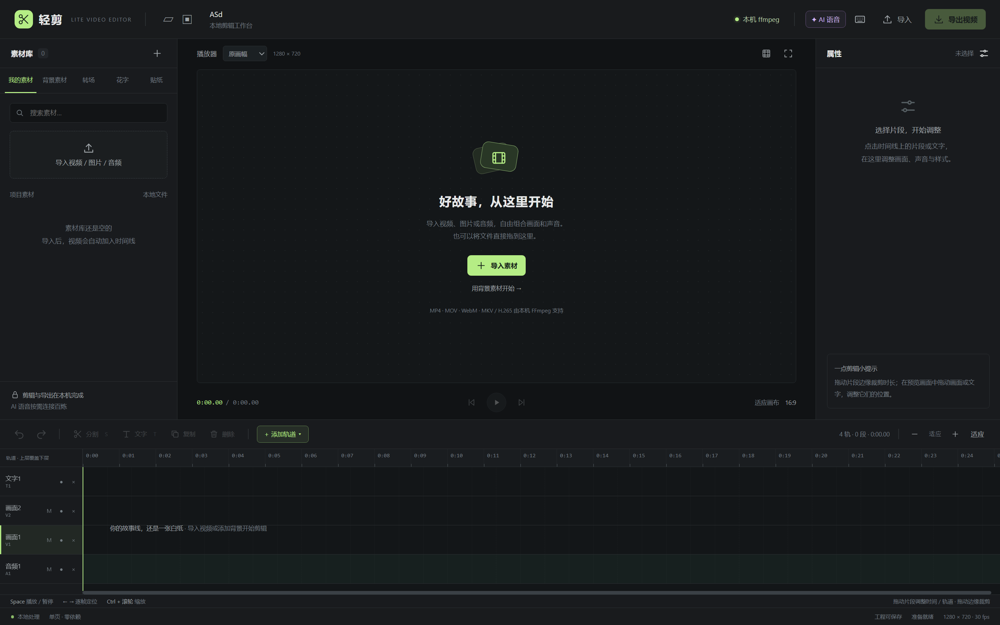
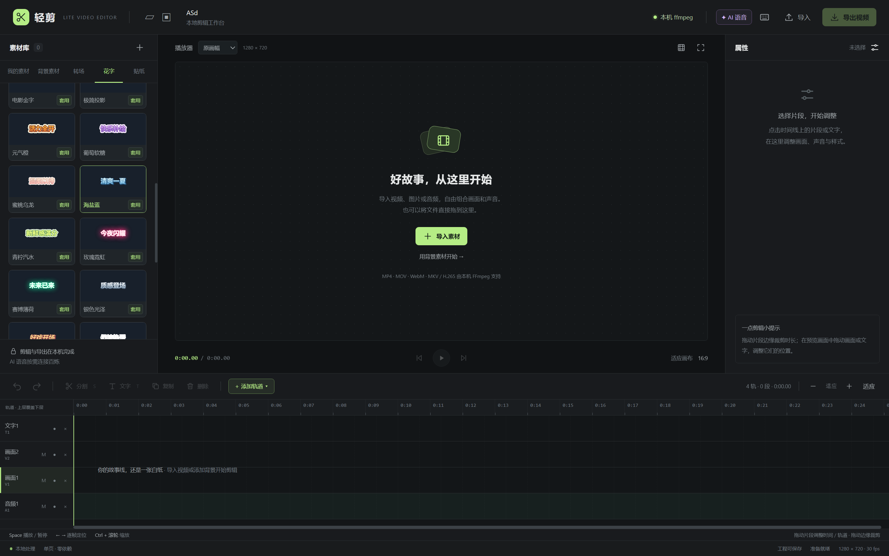
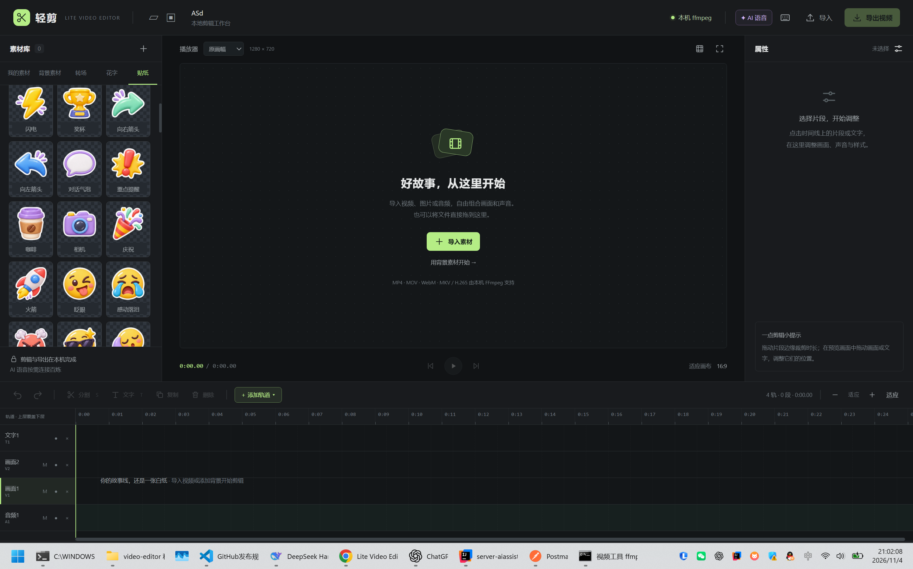

# 轻剪 · Lite Video Editor

<div align="center">
  <a href="README.md">中文</a> · <b>English</b>
</div>

[](LICENSE)

> **Ultra-lightweight. Open it in your browser and start editing.**
> One HTML file, zero dependencies, no installation. Edit and export without FFmpeg, or connect local FFmpeg for faster exports.

## 1. Get started

**Try online:** [Open the browser editor](https://afap.github.io/video-editor-lite/), with no download or installation. Media is processed locally and exported through browser recording. FFmpeg and AI speech are available in the local edition.

**Just open it:** Download the project and open `index.html` in your browser. Import media into the library, then click its “+” button to add it to a track. No Node.js, FFmpeg, or internet connection is required; local editing and built-in assets work offline.

Browser export records in real time and requires keeping the page in the foreground. The output format depends on browser support and may be WebM.

**For faster exports:** Install Node.js 18+, FFmpeg, and ffprobe, add them to your `PATH`, then run this in the project directory:

```sh
npm start
```

Open [http://127.0.0.1:60001/](http://127.0.0.1:60001/) to export through the local FFmpeg bridge. No npm dependencies need to be installed. On Windows, you can also double-click `启动视频工具.bat`.

## 2. Features

- **Multitrack editing:** Import video, images, and audio; start with one visual track and add tracks as needed.
- **Everyday tools:** Multiselect, group, trim, split, ripple delete, selectively paste properties to multiple clips, replace media in place, undo, and redo.
- **Batch image durations:** Filter by original length, change durations, retain transitions, ripple later clips, and optionally adjust background music.
- **Audio tools:** Real waveforms, audio separation, volume, fades, and automatic music ducking that follows selected voice tracks and recovers during pauses.
- **Media usage:** Filter used or unused assets, see reference counts, and jump to their timeline clips.
- **Background removal:** Key out green, black, or a custom color, adjust tolerance and edge softness, and overlay on an upper track in one click.
- **Visuals and animation:** Fit, fill and crop, rotate, flip, image zoom/pan presets, keyframes, and transitions with previews.
- **Precise controls:** Visual, audio, text, and color-key sliders support numeric entry and individual resets.
- **Text and stickers:** 30 editable text styles and 112 built-in transparent stickers.
- **Captions and speech:** Generate styled captions with Bailian, then adjust one cue to sync styling and position across the caption track. Supports SRT, TTS, and text editing; AI settings are saved in the current browser.
- **Project saving:** Save projects, recover drafts, match media from a project folder, and replace missing files individually.

Native export syncs media automatically and supports cancellation and recovery after a disconnect or page refresh.

AI features require the bridge and your own Bailian endpoints, models, and key, entered in the UI. They send the relevant audio or text to the provider and may incur usage charges.

## 3. Screenshots

Editor and multitrack timeline:



Text style presets:



Transparent stickers:



## 4. More information

[Usage guide (Chinese)](docs/usage.md) · [Editing guide (Chinese)](docs/editing.md) · [Sticker assets (Chinese)](assets/stickers/README.md) · [Privacy and security](SECURITY.md)

[MIT](LICENSE) © 2026 AFAP and contributors
