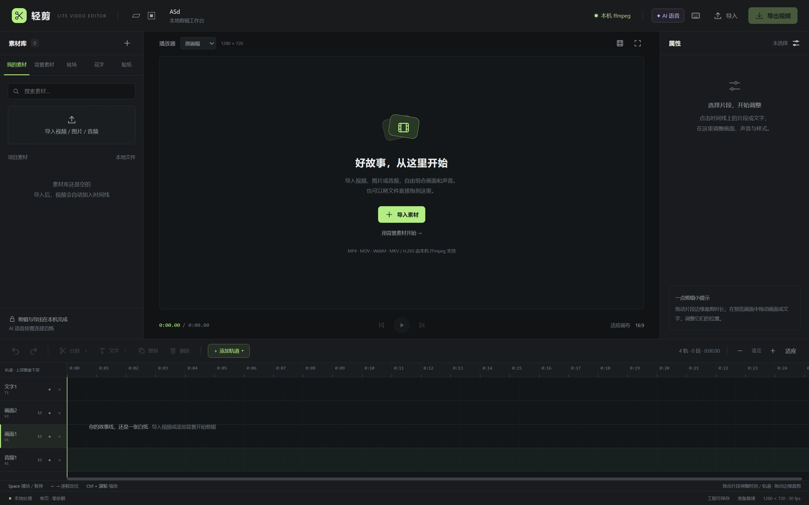
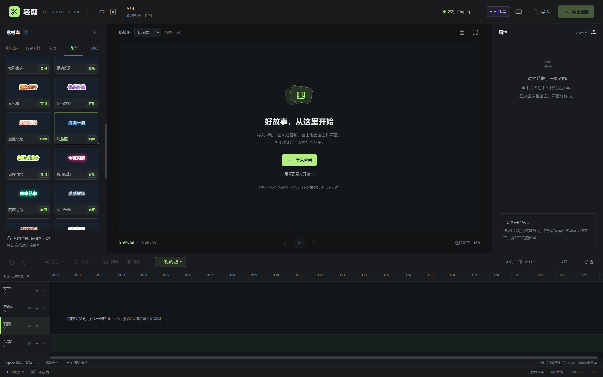
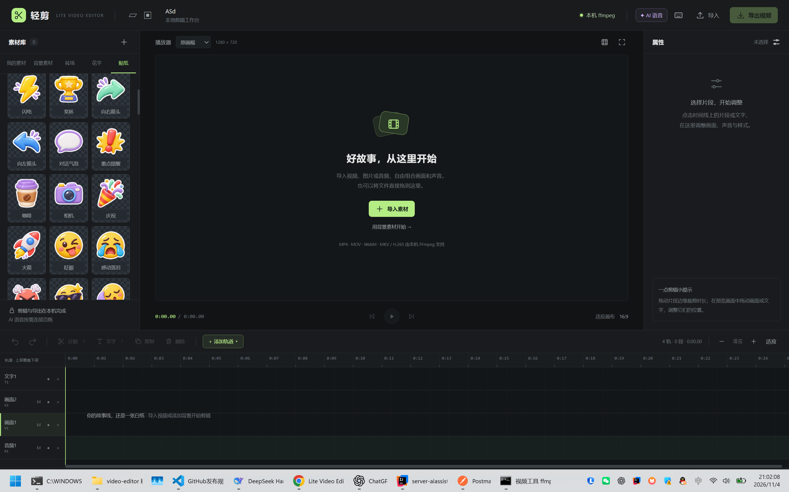

# 轻剪 · Lite Video Editor

<div align="center">
  <b>中文</b> · <a href="README.en.md">English</a>
</div>

[](LICENSE)

> **极致轻量，浏览器打开就能剪。**
> 单个 HTML，零依赖，无需安装。没有 FFmpeg 也能编辑和导出；接入本机 FFmpeg，导出更快。

## 1. 开始使用

**在线体验：** [打开浏览器版](https://afap.github.io/video-editor-lite/)，无需下载或安装。在线版在本机处理素材，通过浏览器录制导出；FFmpeg 和 AI 语音由本机版提供。

**直接打开即可用：** 下载项目，用浏览器打开 `index.html`，导入素材就能开始剪辑。无需 Node.js、FFmpeg 或联网，本地编辑和内置素材均可离线使用。

浏览器导出按实际时长录制，需保持页面在前台；输出格式取决于浏览器，可能使用 WebM。

**想要更快导出：** 安装 Node.js 18+、FFmpeg 和 ffprobe，将它们加入 `PATH`，在项目目录运行：

```sh
npm start
```

打开 [http://127.0.0.1:8787/](http://127.0.0.1:8787/)，即可通过桥接器使用本机 FFmpeg 导出。无需安装 npm 依赖。Windows 也可双击 `启动视频工具.bat`。

## 2. 主要功能

- **多轨剪辑**：导入视频、图片、音频，默认单画面轨，按需添加轨道。
- **日常编辑**：多选、分组、裁剪、分割、波纹删除，支持撤销和重做。
- **声音处理**：真实波形、分离原声、音量与淡入淡出。
- **去背景叠加**：绿幕、黑底或自选颜色抠像，调节容差与柔边，一键叠加到上层轨道。
- **画面与动画**：多种画幅、关键帧动画和可预览的时间线转场。
- **花字与贴纸**：30 套可编辑花字、112 张内置透明贴纸。
- **字幕与配音**：SRT 导入导出，百炼语音识别、自动字幕、TTS 配音与文字润色。
- **工程保存**：保存工程、恢复草稿，尝试自动读取已授权素材，支持逐项替换失效文件。

AI 功能需通过桥接器访问，并在界面填写自己的百炼接口、模型和 Key。启用时会向服务商发送相应音频或文字，按账户用量计费。

## 3. 功能截图

编辑器与多轨时间线：



花字预设：



透明贴纸：



## 4. 更多说明

[详细使用指南](docs/usage.md) · [剪辑操作](docs/editing.md) · [贴纸素材](assets/stickers/README.md) · [隐私与安全](SECURITY.md)

[MIT](LICENSE) © 2026 AFAP and contributors
